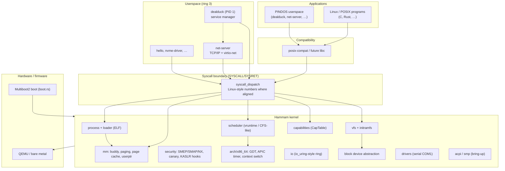

# pindOS

**pindOS** is an experimental operating system for **x86-64**, written mostly in **Rust**. It is built around **Hammam**, a capability-oriented microkernel that runs user programs in isolated address spaces and exposes a **Linux-compatible system call surface** so that existing **Linux and UNIX/POSIX** software can be ported and, over time, run with minimal changes.

## Project goal

The long-term objective is **full compatibility with Linux and UNIX-compatible programs** on PINDOS—not a parallel ABI, but enough parity in syscalls, errno semantics, file descriptors, process lifecycle, and libc expectations that **glibc/musl-linked binaries and POSIX code** can run on Hammam. Work proceeds in layers:

| Layer | Role |
| --- | --- |
| **Hammam kernel** | Memory, scheduling, syscalls, VFS hooks, security |
| **`userspace/posix-compat`** | Thin POSIX/libc-style wrappers mapping to kernel syscalls |
| **Userspace services** | Drivers and network stack outside the kernel where possible |
| **Third-party / ported apps** | Unmodified or lightly adapted Linux/UNIX software |

Today many interfaces are still stubs or partial; the architecture is intentionally aimed at closing that gap rather than reinventing application APIs.

## High-level architecture



### Boot and runtime flow

1. **Multiboot2** loader enters **`boot.rs`**, sets up early page tables, GDT, and hands off to **`_start_multiboot2`** in `hammam/src/main.rs`.
2. The kernel brings up **GDT/IDT**, **security features**, **physical + heap allocators**, and mounts an **embedded initramfs** (cpio) from `userspace_blob`.
3. **`/init`** is loaded as **PID 1** (**dealduck**): ELF load, per-process page tables, and registration with the **scheduler**.
4. **Local APIC timer** drives preemption; userspace invokes the kernel via **SYSCALL/SYSRET** (`arch/x86_64/syscall.rs`).

## Hammam kernel layout

| Module | Responsibility |
| --- | --- |
| `boot.rs`, `multiboot2_*`, `arch/x86_64/entry.rs` | Early boot, long mode, kernel entry |
| `arch/x86_64/` | GDT, legacy PIC, **Local APIC**, **context switch**, **syscall** entry |
| `mm/` | Buddy **physical** allocator, **paging**, kernel **heap**, **page cache**, user buffer validation |
| `sched/` | Runnable tasks, **vruntime**-based scheduling, `yield` / timer ticks |
| `process/` | Process table, **fd table** (stdin/stdout/stderr → COM1), integration with scheduler |
| `loader/` | **ELF** loading (including PIE relocation) |
| `vfs/` | Vnode trait, path lookup, **initramfs** |
| `cap/` | **Capabilities** (memory, IRQ, I/O ports, process) and per-process handles |
| `security/` | SMEP, SMAP, NX, stack canary, KASLR helpers |
| `io/` | Submission/completion ring (io_uring-inspired) for async I/O path |
| `block/` | Generic block device trait |
| `drivers/serial` | **COM1** kernel console and early userspace I/O |
| `acpi/`, `smp/` | ACPI MADT parsing, AP bring-up (in progress) |
| `interrupts.rs` | IDT and exception handling |

Design themes: **microkernel-style separation** (network stack and many drivers live in userspace), **defense in depth** on the syscall path (user pointer checks, SMEP/SMAP), and **capability-based** access to sensitive resources instead of a monolithic driver model in ring 0.

## Userspace components

| Crate / path | Description |
| --- | --- |
| **`dealduck/`** | PID **1** init and **service manager**; spawns and supervises userspace daemons via syscalls |
| **`userspace/net-server/`** | **Userspace TCP/IP** (smoltcp) over **virtio-net**; kernel exposes DMA/memory via syscalls |
| **`userspace/posix-compat/`** | POSIX wrappers (`read`, `write`, `exit`, …) targeting Hammam syscalls |
| **`userspace/hello/`** | Minimal test binary |
| **`userspace/nvme-driver/`** | Storage driver experiment in userspace |

Network and storage direction: keep **policy and protocols in userspace**, keep the kernel focused on **scheduling, memory, capabilities, and a stable syscall boundary**.

## System call interface (current)

Dispatch is centralized in `syscall_dispatch`. Numbers follow **Linux x86-64** where practical:

| NR | Handler | Notes |
| ---: | --- | --- |
| 0 | `sys_yield` | Cooperative / scheduler integration |
| 1 | `sys_write` | FD table → console, etc. |
| 2 | `sys_exec` | Load/run ELF from VFS path |
| 3 | `sys_waitpid` | Process wait |
| 4 | `sys_time` | Monotonic time (ms) |
| 5 | `sys_dma_alloc` | DMA-capable pages for userspace drivers |
| 60 | `sys_exit` | Linux `exit` number |

Unimplemented calls return **`-ENOSYS` (-38)**. Expanding this table toward Linux parity is the main kernel/userspace compatibility track.

## Repository layout

```
PINDOS/
├── hammam/              # Hammam kernel (hammam-kernel crate)
├── dealduck/            # /init — PID 1 service manager
├── userspace/           # net-server, posix-compat, hello, nvme-driver, …
├── drun.py              # Build, check, QEMU test, release ISO
├── iso_root/            # GRUB / ISO layout for releases
├── drunned/             # QEMU run artifacts, logs
├── KNOWN_ISSUES.md      # Engineering notes (e.g. virtio-net timing)
├── AGENTS.md            # Boot/linker change protocol for contributors
└── LICENSE.txt          # GPL-3.0
```

## Build and run

Requirements: **Rust** nightly/stable with `x86_64-unknown-none` target, **QEMU**, and dependencies installed via the project script.

```bash
python drun.py -get    # install toolchain dependencies
python drun.py -b      # debug build
python drun.py -c      # cargo check all components
python drun.py -T      # build + run in QEMU (serial on COM1)
python drun.py -r TAG  # release ISO for bare metal (see script for tag)
```

Serial output from QEMU is the primary integration test for boot and init; see `AGENTS.md` for mandatory verification when changing boot, entry, or linker scripts.

## Status

PINDOS is **research and bring-up** quality: boot, scheduling, ELF init, initramfs, basic syscalls, and a userspace network demo are in place; **fork**, full **open/read** VFS syscalls, SMP, and broad Linux ABI coverage are still **work in progress**. See `KNOWN_ISSUES.md` for active hardware/QEMU quirks.

## License

This project is licensed under the **GNU General Public License v3.0** — see [LICENSE.txt](LICENSE.txt).
